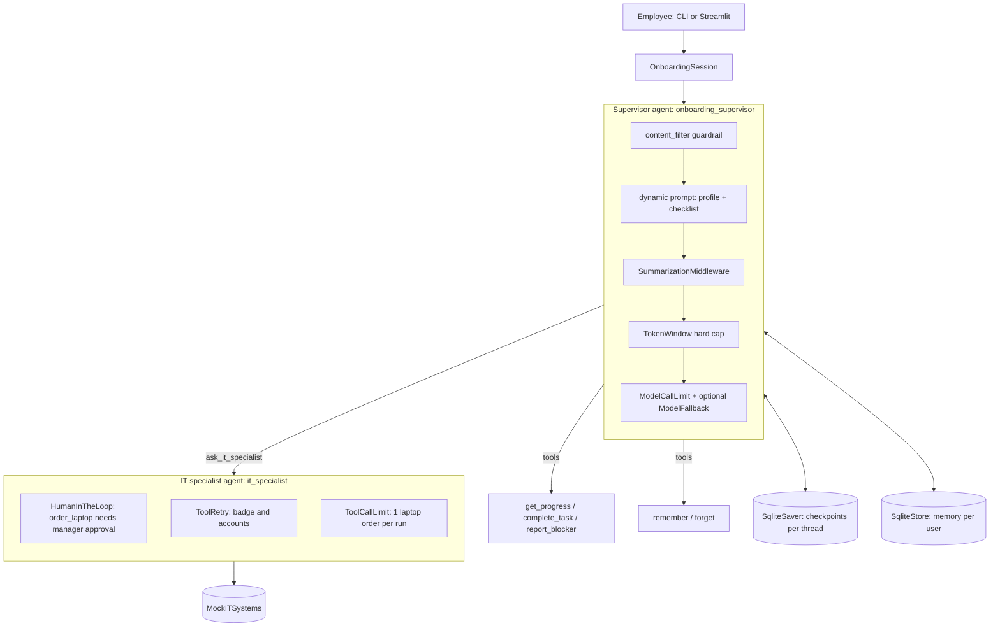

# Onboarding Buddy

A local agent that helps a new employee through an onboarding checklist. It runs on Ollama and is built with LangChain v1 and LangGraph. All external systems are mocked.

## Architecture



| Requirement | Where it lives |
|---|---|
| System prompt | `middleware.onboarding_prompt` (dynamic: memories + checklist) and `agents.IT_SPECIALIST_PROMPT` |
| Two agents, one with tools | Supervisor plus an IT specialist sub-agent, exposed to the supervisor as the `ask_it_specialist` tool |
| State | `state.OnboardingState`: `completed_tasks` and `blocked_tasks`, using reducers |
| Middleware for tools and agents | HITL, ToolRetry, ToolCallLimit, ModelCallLimit, ModelFallback, guardrail |
| Middleware for context bounds | `SummarizationMiddleware` plus the `TokenWindow` hard cap |
| Persistence | SQLite checkpointer. Restart the app and the conversation continues; pending approvals survive a restart. |
| Long-term memory | SQLite Store, namespaced by `user_id` taken from context (never from model output) |

## Quickstart (WSL)

```bash
cd "/mnt/c/Users/asalama/Documents/Learning/LangChain CoE/onboarding-agent/project"
source ~/venvs/langchain-coe/bin/activate
pip install -r requirements.txt
ollama pull llama3.2

python3 cli.py --user sara --name Sara --role "data engineer"   # terminal
streamlit run streamlit_app.py                                  # web UI at http://localhost:8501
```

CLI commands: `/progress`, `/memories`, `/forget-me`, `quit`.

Things to try:
- *"I finished my HR paperwork, and I'm vegetarian."*
- *"Order me a MacBook Pro 16."* The manager approval prompt appears.
- *"Set up my email and vpn."* The VPN mock is down, so this shows retries and then an honest error.
- *"Is my badge ready?"* The badge mock fails once, so the retry succeeds.

## Configuration (environment variables)

| Variable | Default | Purpose |
|---|---|---|
| `ONBOARDING_MODEL` | `llama3.2` | Ollama model for both agents |
| `ONBOARDING_FALLBACK_MODEL` | *(none)* | Backup model used by `ModelFallbackMiddleware` |
| `ONBOARDING_NUM_CTX` | `8192` | Ollama context window. Ollama silently truncates beyond this. |
| `ONBOARDING_DATA_DIR` | `~/onboarding-data` | SQLite files. Keep them on the Linux filesystem, not `/mnt/c`. |
| `ONBOARDING_CONTEXT_TOKENS` | `3000` | Hard cap on history tokens sent to the model |
| `ONBOARDING_SUMMARY_TRIGGER_TOKENS` | `2500` | History size that triggers summarization |

## Tests

```bash
python3 -m pytest --cov=onboarding --cov=cli --cov=streamlit_app
```

Tests are hermetic and need no Ollama. A `ScriptedModel` replays tool calls, and Streamlit is tested with `AppTest`.

## Design notes

- **The IT specialist has no checkpointer of its own.** It inherits the supervisor's, so an approval interrupt inside the sub-agent pauses the whole conversation and resumes in place.
- **`ask_it_specialist` returns the raw IT tool results alongside the specialist's summary.** `llama3.2` otherwise misreported edited orders and failed accounts.
- **Laptop orders use an idempotency key (`<user>-laptop`),** so retries or repeated requests never buy a second laptop.
- **The guardrail checks the newest message, not `messages[0]`,** and matches whole words, so "hackathon" is allowed.
